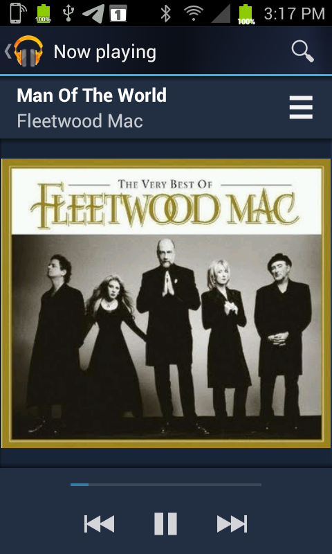
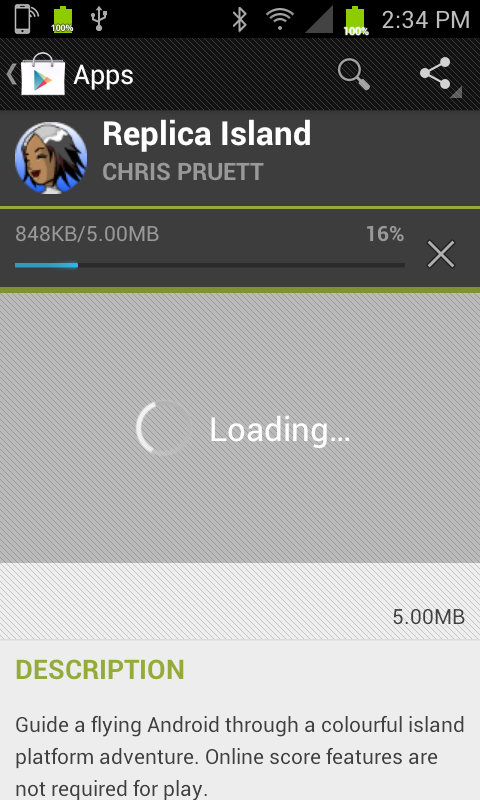
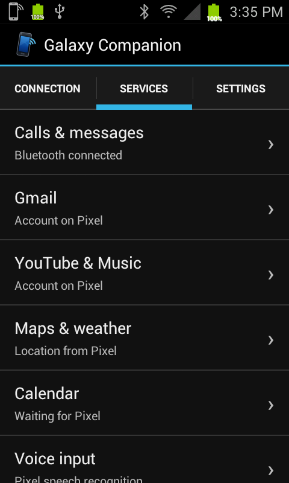
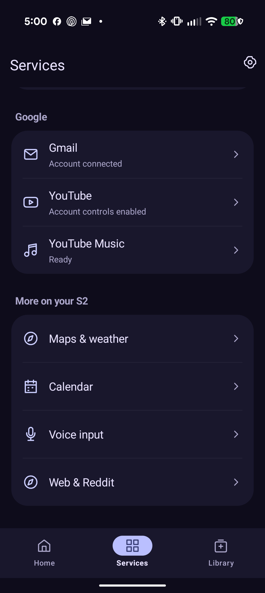

# Galaxy S2 Companion

Use an Android 4.0.4 Galaxy S2 through a modern Android phone, with the old phone's original dialer, messaging, maps and media interfaces wherever possible.

The S2 connects to the modern Android phone over Bluetooth and private Wi-Fi. The modern Android phone provides calls, texts, modern network access and account sessions. A PC is needed for building and initial setup; everyday operation is designed to work with the PC unplugged.

**This is an experimental source kit, not a one-click installer.** The development phone was the **Sprint Samsung Epic 4G Touch (SPH-D710), Android 4.0.4, IMM76I.FL24**, paired with a Pixel 9 Pro. Native calling/audio changes require that exact old firmware. Another Galaxy S2 model is not interchangeable. Never remove a firmware or identity check to force installation.

A Pixel is not a brand requirement. **The current full setup targets a modern Android 16+ phone**, with feature-specific requirements; only the Pixel 9 Pro development pairing has been tested. Read the [compatibility matrix](docs/COMPATIBILITY.md) before buying hardware or assuming another phone works. Older declared minimum SDK values are not an end-to-end support guarantee.

## Screenshots

  
  
  

  
  

[See every restored app in the screenshot gallery](docs/SCREENSHOTS.md). These are real captures from the development installation, with personal information covered where needed. The public APK library starts empty.

## Choose your setup guide

- **[Local prerequisites and inputs](docs/INPUTS.md)** — exact tools, original input files and a no-device preflight.
- **[Manual setup](docs/MANUAL_SETUP.md)** — prerequisites, build commands and ordered checkpoints.
- **[AI-assisted setup](docs/AI_SETUP.md)** — a ready-to-copy prompt and instructions for a coding assistant with local device access.
- **[Contacts, camera and notifications](docs/CONTACTS_CAMERA_NOTIFICATIONS.md)** — enable switches, permissions, upgrades and no-PC checks.
- **[AP Mobile widget](docs/AP_MOBILE.md)** — build from your own original firmware and restore science/space headlines.
- **[Recovery](docs/RECOVERY.md)** — read before changing the S2 system partition.
- **[Validation and remaining gaps](docs/VALIDATION.md)** — distinguishes the original working phones from the generalized public build.
- **[Isolated emulator checks](docs/EMULATOR_TESTING.md)** — fresh installation tests without accessing a working phone.

## Features

| Feature | What the bridge provides | Limits |
| --- | --- | --- |
| Samsung Phone | Calls from the modern Android phone number, stock dialer, ringing, answer/end, earpiece/microphone and mute | Exact-firmware native integration and S2 root required |
| Samsung Messaging | Bluetooth SMS; optional RCS notification text and inline replies; photo/video relay paths | One-to-one messaging; incoming video and RCS attachments are not fully validated |
| Telegram, optional | Classic chat list/history, text, photos, camera/gallery sending, videos, files, stickers and reactions | Separate companion and own TDLib session; voice messages deferred |
| Maps / Navigation | modern Android phone location mirrored into the old interface | Backend availability and map coverage remain external dependencies |
| Weather / Calendar / browser | Compatibility endpoints, private HTTPS proxy and modern upstream connections | Old rendering and discontinued-service limitations remain |
| Voice input / Google widget | Recognition performed through the modern Android phone, including supported keyboard/app entry points | Different keyboards and microphones need their own test |
| YouTube | Search, feeds, subscriptions, comments and account controls; compatible segmented video | Some original buttons have no modern equivalent; see media guide |
| Reddit is fun | Public posts/comments and compatible media | No login; upstream public access may change |
| Play Music | YouTube Music likes, owned/saved playlists, uploads, artwork and audio-only streaming | Own Google authorization; saved albums are not synced; upstream changes can break adapters |
| Gmail | Original inbox interface with modern Android phone account authorization, mail actions and attachments | Separate Google permission and API project required |
| Contacts | Automatic one-way sync into Samsung Contacts and the original dialer | Modern phone is authoritative; unrelated S2 contacts retained |
| Camera backup | New camera JPEGs and MP4/3GP videos in one modern-phone Pictures/Galaxy S2 album | Resumable, checksum-verified; originals retained; no historical gallery mirror |
| AP Mobile | Original Samsung widget/list with NASA science and space headlines and pictures | Owner-supplied exact-firmware APK/odex inputs; discontinued AP service is not restored |
| Notification forwarding | Selected modern-phone alerts with app names, icons and previews | Off by default; duplicate/service alerts excluded; no general remote actions |
| 2012 Play Store interface | Private modern Android phone APK library, local search, installed apps, download/install progress | **Empty by default. Bring your own APKs.** No Google Store login, billing or license bypass |

The modern Android phone has one main Galaxy Companion interface with account and runtime components behind it. The S2 uses an Android 4-style Connection / Services / Settings interface. Telegram remains optional and separate. Shared background status reduces notification clutter; the background services still need Android's required permissions and notifications.

## What you supply

Your own compatible phones, recovery method, original applications and firmware inputs, signing key, Bluetooth pairing, and any Google/Telegram account authorization you choose to use. The repository uses neutral `org.retrobridge.*` package names. Each person builds and signs their own packages and registers their own API clients.

**No APK collection is bundled.** Add your own compatible files using the modern phone's **App library → Add APK**. Free to download does not mean free to redistribute. A future bundled entry must have an explicit redistribution license/permission and its required notices/source; archive.org availability alone is not permission. See [Store and APK library](docs/STORE.md).

There are no personal backups, account credentials, messages, contacts, device identifiers or developer signing keys in this repository. Generated files stay under ignored `.local/`. Do not upload your configuration or runtime data when asking for help.

## Setup order

1. Inventory both devices and establish a restorable S2 backup.
2. Build and validate [calling and SMS](docs/CALLS_SMS.md).
3. Pair the compatibility services and review the [private HTTPS trust](PRIVACY.md).
4. Enable [contacts, camera and selected notifications](docs/CONTACTS_CAMERA_NOTIFICATIONS.md), and optionally the [AP Mobile widget](docs/AP_MOBILE.md).
5. Add [Google accounts / Gmail](docs/GOOGLE_ACCOUNTS.md), [media apps](docs/MEDIA_APPS.md), [Store](docs/STORE.md) and [Telegram](docs/TELEGRAM.md) as separate checkpoints.
6. Test reboot/reconnection and each selected feature with both phones unplugged from the PC.

## Source map

- `source/sms-companion-v12`: current S2 call/SMS control app; the directory name is historical (current manifest version 15).
- `source/stock-*`: exact-firmware native calling, identity checks and guarded installers.
- `source/legacy-services`: current modern Android/S2 data services (versions 37/16), private network, camera, messaging and catalog endpoints.
- `source/ap-mobile`: guarded local patch recipe for the original Samsung news widget; no vendor APK/resources included.
- `source/pixel-consolidation` and `source/gmail-bridge`: shared modern Android phone UI and Google account component; local Gmail patch.
- `source/play-store-investigation`: local Store patch and narrowly scoped privileged installer helper.
- `source/youtube-google`, `gallery-music`, `reddit-compatibility`: app patches and modern Android phone runtime adapters.
- `source/telegram-*`: optional chat companion, engine recipes and owner-supplied classic artwork preparation.
- `tools`: local configuration, dependency fetching, build dispatch, pairing and publication audit.

Not an official Samsung, Google, Telegram or Reddit product. Use the modern Android phone directly for emergency calls. Read [privacy](PRIVACY.md) and [third-party notices](THIRD_PARTY_NOTICES.md). First-party additions are Apache-2.0 unless stated otherwise; this does not relicense original applications.
