# App screenshot gallery

Actual captures from the development installation, covering each restored user-facing app. Screens containing private content use solid black privacy blocks over names, addresses, conversations, appointments, photos or locations. The original pixels outside those blocks are unchanged; no interface was generated or reconstructed. Background helpers are represented by the consolidated Companion interfaces.

These images illustrate the interfaces, not a fresh-install compatibility guarantee. Some installed labels still say Pixel; the [compatibility guide](COMPATIBILITY.md) describes modern Android phone requirements. The [validation report](VALIDATION.md) records what was tested and what remains unverified.

| App or interface | Example |
| --- | --- |
| Samsung Phone | [Original dialer](#samsung-phone) |
| Samsung Messaging | [Messaging interface](#samsung-messaging) |
| Gmail | [Original inbox](#gmail) |
| YouTube | [Search results](#youtube) |
| Google Maps | [Public landmark](#google-maps) |
| Navigation | [Destination shortcuts](#navigation) |
| Weather | [Original weather interface](#weather) |
| Calendar | [Month view](#calendar) |
| Internet browser | [Public HTTPS page](#internet-browser) |
| Google widget and voice-search entry | [Home-screen widget](#google-widget) |
| Gallery and camera backup | [Original Gallery](#gallery-and-camera-backup) |
| Telegram | [Main Chats screen](#telegram) |
| Google Play Music | [Now playing](#google-play-music) |
| Reddit is fun | [Posts and comments](#reddit-is-fun) |
| 2012 Store | [APK download](#2012-store) |
| Galaxy Companion | [S2 and modern Android interfaces](#galaxy-companion) |

## Samsung Phone

The original Samsung dialer. No number is entered and no call was placed for this screenshot. [Calling setup](CALLS_SMS.md).

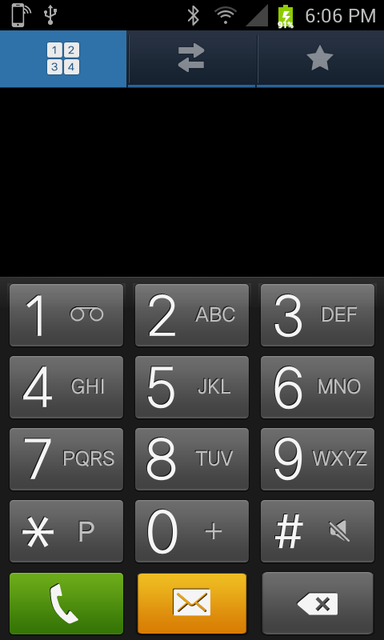

## Samsung Messaging

The original empty message composer, attachment button and Swype keyboard. No recipient or message was entered, and nothing was sent for this capture. [Messaging capabilities and limits](CALLS_SMS.md).

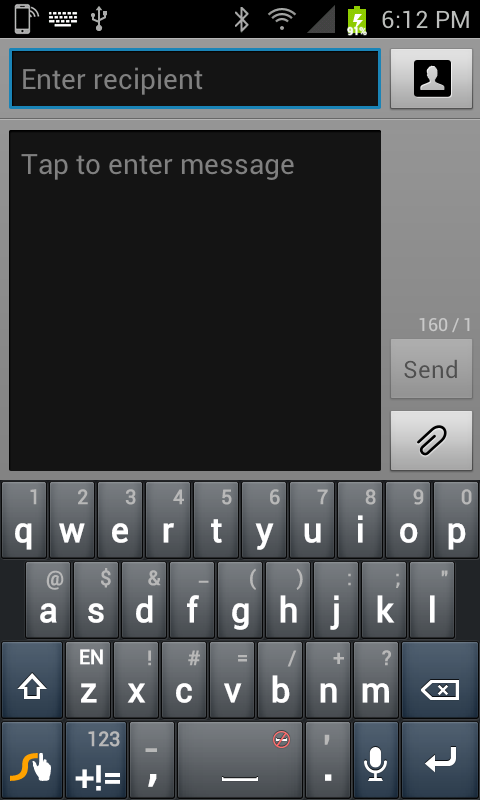

## Gmail

The original inbox and toolbar. The account address, senders, subjects, message previews and timestamps are covered. [Google authorization and Gmail setup](GOOGLE_ACCOUNTS.md).

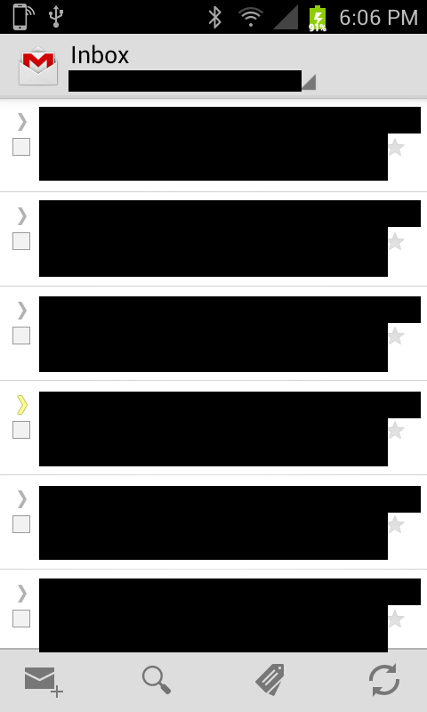

## YouTube

A public NASA search in the original YouTube interface. [Media setup and limits](MEDIA_APPS.md).

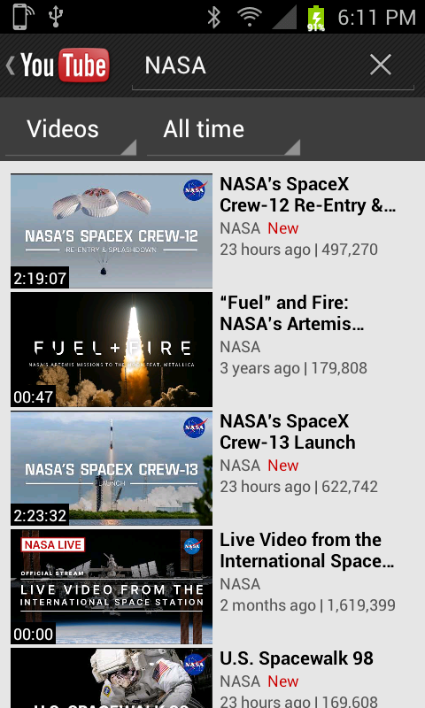

## Google Maps

Maps displaying Liberty Island and Ellis Island, selected as public landmarks rather than the phone's location.

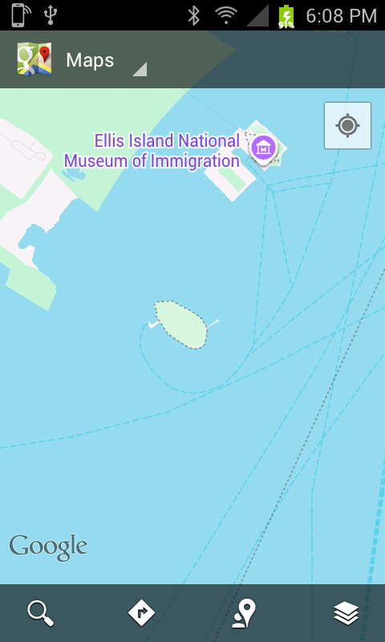

## Navigation

The original destination shortcuts, with recent destinations and addresses covered. No route was started for this capture.

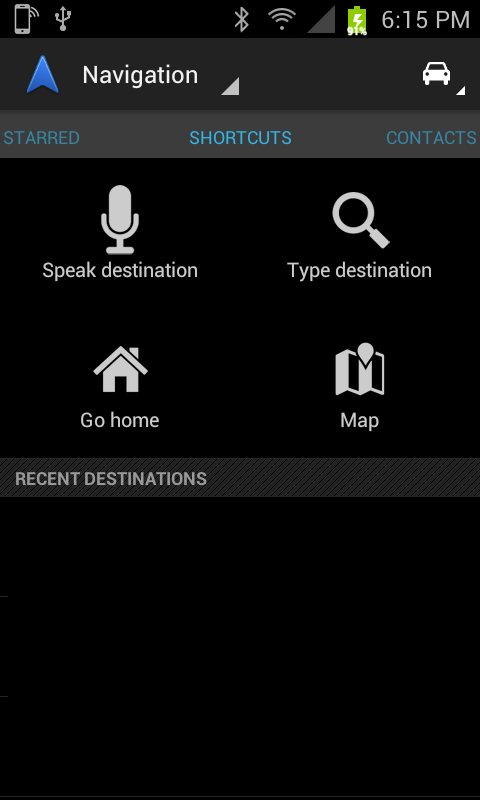

## Weather

The original weather interface displaying its cached forecast. The city and region are covered; the visible update date is retained, so this is an interface example rather than a current-weather check.

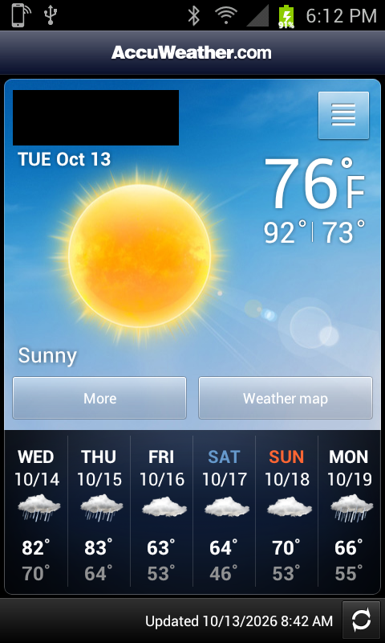

## Calendar

Samsung Calendar's month view. The selected appointment's time and title are covered; no event was opened or changed.

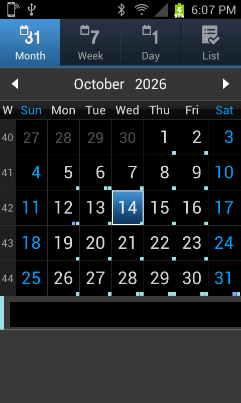

## Internet browser

The stock Internet browser displaying the public example.org HTTPS page through the compatibility connection.

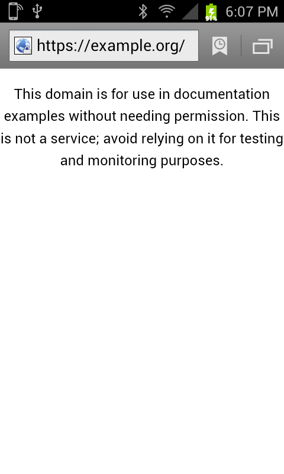

## Google widget

The original Google search widget and its microphone entry point. A screenshot shows the interface; the separate speech-recognition checks are described in the setup and validation guides.

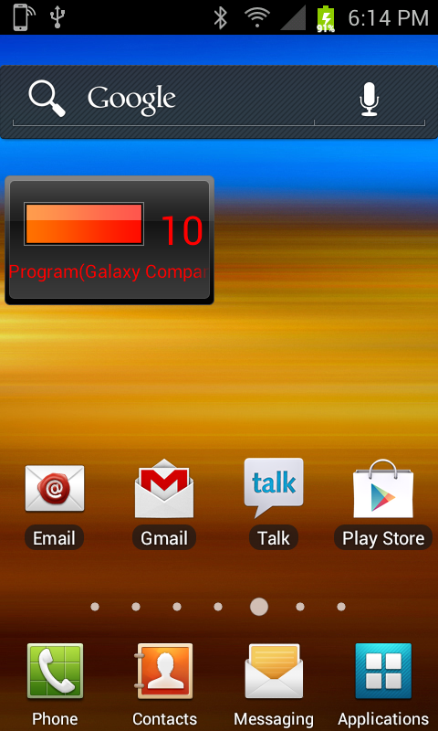

## Gallery and camera backup

The original Gallery remains on the S2. Personal camera thumbnails and other personal albums are covered; the visible test image and test video were generated for earlier checks. The added feature backs up new S2 camera JPEGs to the modern Android phone. It does not mirror the modern phone's gallery or sync deletions.

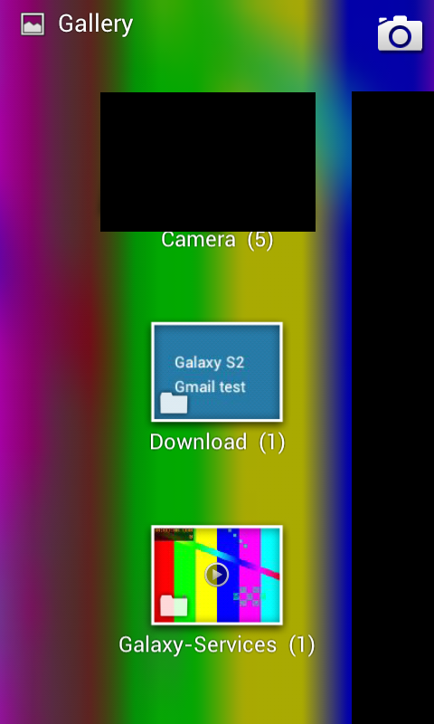

## Telegram

The main Chats screen in the optional classic Telegram companion. Chat names, avatars and message previews are covered; dates, the original header, spacing and row separators are unchanged. [Telegram setup](TELEGRAM.md).

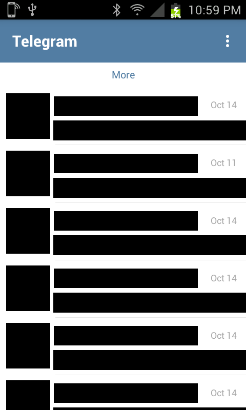

## Google Play Music

The original Now playing interface, artwork and playback controls. This public catalog track was used during playback testing; no account or personal library listing is shown. [Music setup and limits](MEDIA_APPS.md#play-music-interface-with-youtube-music).

## Reddit is fun

Public subreddit posts and comments in the original RIF interface, without a Reddit login. Visible authors and comments belong to the public feed, not private conversations or the phone owner's account. [Media setup and limits](MEDIA_APPS.md).

  
  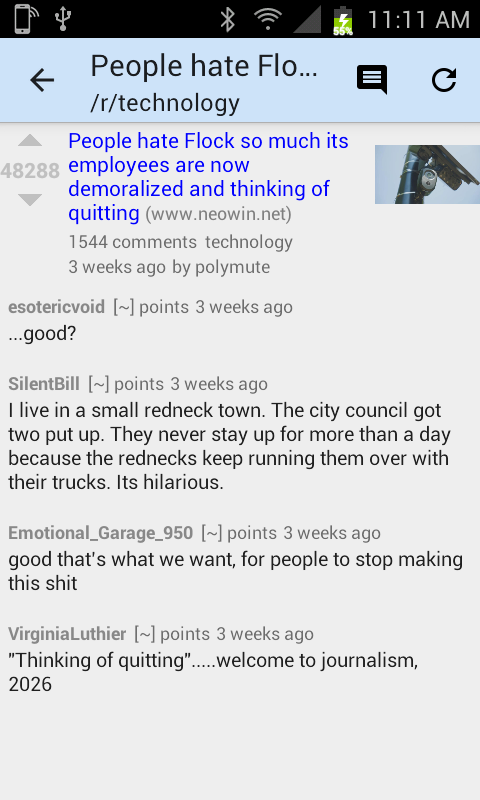

## 2012 Store

The original Store downloading an example APK from the private library. The detail page is still loading in this recorded capture. The public setup includes no APK collection; each operator supplies their own compatible files unless redistribution is explicitly permitted. [Store setup](STORE.md).

## Galaxy Companion

The consolidated S2 services and settings, followed by the modern Android phone's services screen. These cover the supporting call, network, media and backup helpers rather than showing each hidden component as a separate app.

  
  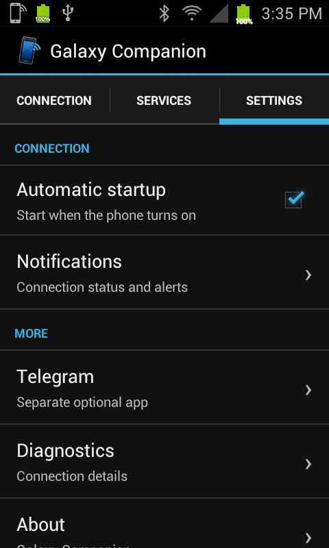
  

All 19 published captures are visually reviewed and stripped of personal embedded metadata; the modern Companion image retains only its standard sRGB color tag. Private originals and redaction receipts stay outside this repository. Do not upload unreviewed account, chat, mail or diagnostic screenshots to issues.
